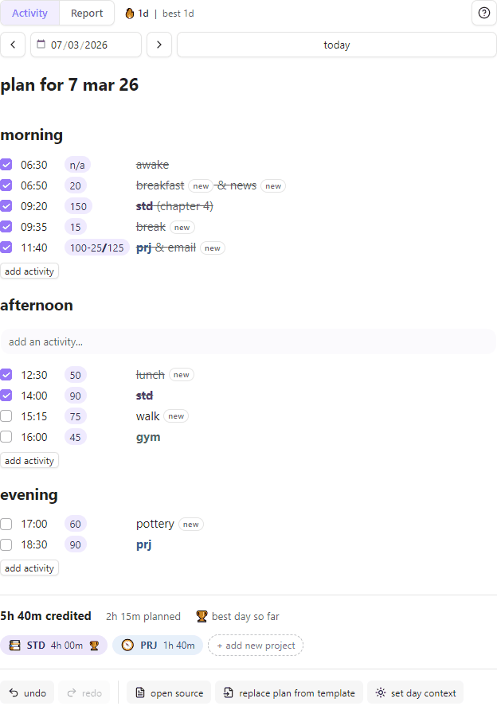
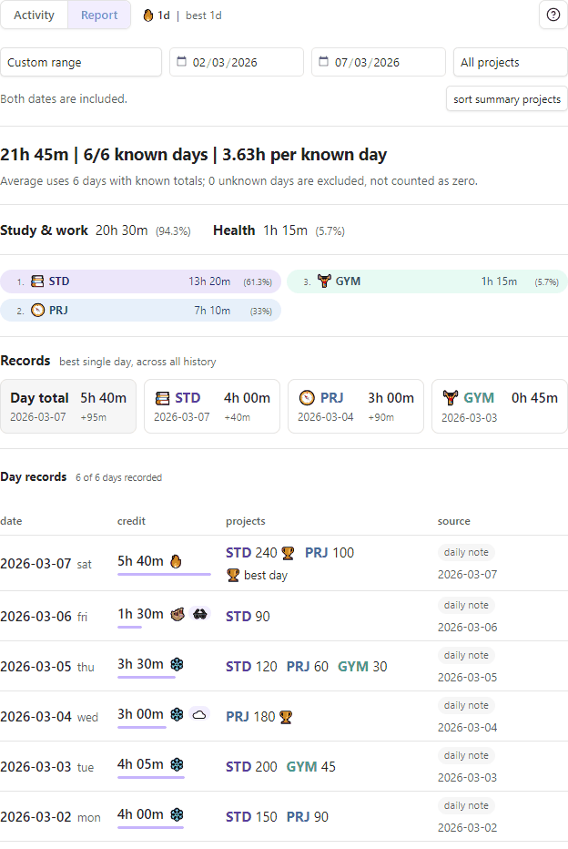

# THEJAZ Planner

Plan your day, log what you actually did, and review where your time went, all
in ordinary Markdown daily notes that stay readable and editable without the
plugin.

- **Quick daily planning.** Type `14:30 30 prj` and Planner writes
  `- [ ] 14:30 (30) : prj` into today's note. End times, durations, and split
  credit (`20-30/50 wrk & party`) are calculated for you; `now` and `fill` stand
  for the current time and the gap before the next activity.
- **Accurate totals.** Each day keeps plain `PRJ = 60` … `SUM = 60` totals, and
  summary notes collect per-day minutes and markers across a period. Planner
  never silently rewrites figures it cannot verify.
- **Reviews and records.** The Report view shows totals, group shares, ranges,
  streaks, your best day per project, and a day-by-day list with each day's
  markers and source note. A day that beats every earlier day is marked
  `==new record==` in its summary.
- **Tidy logs.** Correct times, shift plans, and combine repeated rows such as
  `nve`, `org`, `nve` into one `nve & org` row. Advisory warnings read once, link
  to their lines, and can be ignored.
- **Keyboard first.** Single-key row actions, Undo/Redo, and a built-in keyboard
  reference (`?`).
- **Safe by design.** Every change previews or can be undone, a concurrent edit
  blocks the write, and interrupted operations can be recovered.

## Screenshots

**Activity.** Plan the day, check off what you did, and see credited time per project.



**Report.** Totals, group shares, records, and a day-by-day list for any range.



## Getting started

1. Install and enable **THEJAZ Planner** in Settings → Community plugins.
2. Run **THEJAZ Planner: Open planner** from the command palette, or click the
   sun icon in the ribbon.
3. Pick a day and choose **Create day**: start blank, from your own routine
   notes, or from **🌞 ordinary day**, which Planner then adds to your routines
   folder (`THEJAZ` by default) as a note you can edit. Planner creates the daily
   note `YYYY-MM-DD.md`, which starts with `## plan for 5 oct 26`. If you already
   keep dated notes, choose a prefix or suffix in Settings > Daily setup (for
   example `plan 2026-10-05.md`) so they are left alone.
4. Optionally create `thejaz-summary-now.md` for period totals and
   `thejaz-criteria.md` for marker rules. See the [user guide](docs/user-guide.md).

A minimal daily note looks like this. Each time is when that activity ended, and
the number in parentheses is its minutes:

```markdown
## plan for 5 oct 26

### morning
- [x] 08:00 (n/a) : awake
- [x] 09:30 (90) : prj
- [ ] 10:00 (30) : std

---

PRJ = 90
SUM = 90
```

A dated note without a plan heading is never changed. Creating a day whose name
such a note already uses asks before adding a plan above its text.

## Quick entry

Fields follow the order of a source row: end time, minutes, activity. Time and
minutes are optional.

| You type | Planner saves |
| --- | --- |
| `prj` | the default block (40 minutes) after the selected row |
| `50 prj` | 50 minutes after the selected row |
| `14:30 prj` | ends 14:30; minutes calculated from the previous end time |
| `now prj` | ends now, in your configured time zone |
| `fill prj` | ends where the next activity starts, filling the gap |
| `14:30 70/120 prj` | 70 minutes of credit out of 120 elapsed |
| `22:25 35-35/70 prj & std` | 35 minutes for each project |
| `14:30; 30; read 2 chapters` | semicolons separate fields, so names may hold numbers |
| `14:30 30 : prj` | a colon marks where the name starts, as in the note |
| `...` or `14:00 >` | a placeholder (the next row counts from the last end time), or a restart |

Only registered project codes earn credit; other words are ordinary activities.
A name no earlier day has used carries a small **new** tag.

## Keyboard

| Key | Action |
| --- | --- |
| Up / Down, Shift + Up / Down | Select an activity, or extend the selection |
| `A` / `E` / Space | Add below, edit, toggle completion |
| `S` / `R` / `M` | Shift, correct, or combine the selected activities |
| `D` / `K` / `J` / `X` | Duplicate, move up, move down, delete |
| `V` / `C` / `,` / `?` | Activity/Report, day context, settings, help |
| Ctrl + Z / Ctrl + Shift + Z | Undo / redo the last planner change |

Keys work while the planner has focus and never while you type in a field.

## Privacy and data

- Planner makes no network requests and collects no telemetry. Its only web
  address is a link to the author's GitHub page in Settings, which opens in your
  browser when you click it.
- It reads candidate daily notes, summary notes, the shared criteria note, and
  routine templates in your vault to recognize planner content. It changes
  planner notes through the actions and automatic totals described in the
  [user guide](docs/user-guide.md).
- Settings and local working data live in its plugin folder, normally
  `.obsidian/plugins/thejaz-planner/` (under your configured vault config folder).
  `index.json` caches the **full text** of indexed planner days and summaries.
  Recovery snapshots can contain **full daily-note text**, other small-note
  text, changed text, and settings checkpoints for undo and crash recovery.
- Finished recovery history is pruned when saved: at most 30 days, 100 resolved
  operations, and about one million stored characters. Pending/interrupted
  operations and unfinished summary updates remain until resolved, even beyond
  those limits. Two alternating recovery snapshots protect against failed saves;
  an older copy can remain until replaced. If neither can be read, both are kept
  aside as `recovery-unreadable-...` copies until you delete them. These limits are not secure deletion.
- Cache and recovery files are readable local data, not encrypted by Planner.
  Treat them like your notes: exclude them from public repositories and support
  uploads. Planner does not transmit them; your sync or backup tools may include
  them according to your configuration.
- No plugin-specific metadata is added to your notes. Settings, project groups,
  and ignored warnings are kept in the plugin folder; record marks and totals are
  ordinary Markdown you can edit or remove.

Desktop only. Windows is the tested platform.

## Install

Install **THEJAZ Planner** from **Settings → Community plugins → Browse**. To
update an existing installation, check for updates in **Community plugins**.

For a manual install or update, download `main.js`, `manifest.json`, and
`styles.css` from the [latest GitHub release](https://github.com/thejaz/planner/releases/latest).
Disable Planner if it is running. Copy those three files into
`.obsidian/plugins/thejaz-planner/` in your vault, creating the folder on first
install. Keep the other files in that folder to preserve settings and Undo
history. Reload Obsidian and enable **THEJAZ Planner**.

The [user guide](docs/user-guide.md) covers everything else: moving from the old
`plain-planner` ID, plans, summaries, markers, project management, review, and
recovery. Developer notes: [Maintaining Planner](docs/maintaining.md).

Created by [THEJAZ](https://github.com/thejaz/).
